# 校园头条 · Campus Headlines

面向高校场景的前后端分离内容平台，采用 **SSM 架构（Spring + Spring MVC + MyBatis-Plus）**，
对应《Java EE 企业级应用开发教程》第 14 章「黑马头条」的业务闭环，并扩展为
**普通用户、作者、审核员三端协作**的校园资讯系统。

- 后端：SSM（Spring 5.3 + Spring MVC 5.3 + MyBatis-Plus 3.5.3.2）+ MySQL 8.0 + JWT
- 前端：Vue 3.4 + Vite 5 + Element Plus 2.8 + wangEditor 5
- 环境：JDK 17 / Maven 3.6+ / Node 18+ / MySQL 8.0
- 角色：普通用户（浏览）、作者（发布/素材）、审核员（审核）

---

## 一、三端角色与功能

| 角色 | 注册 / 登录 | 权限 |
| --- | --- | --- |
| 普通用户 | 支持注册、验证码/密码登录 | 浏览频道、文章列表、文章详情；修改个人资料；上传头像 |
| 作者用户 | 支持注册、手机号/密码登录 | 素材管理、发布文章、存草稿、提交审核、查看自己的内容 |
| 审核员 | 支持注册、手机号/密码登录 | 审核工作台：查看全文、通过并发布、驳回并填写意见 |

### 业务闭环

1. 作者上传封面图片（图片二进制保存到数据库 material.data）。
2. 作者发布文章，选择数据库中的封面，提交审核。
3. 审核员在审核工作台查看全文，通过或驳回；审核记录写入 audit_record。
4. 审核通过后文章立即出现在普通用户端，封面从 /api/files/material/{id} 读取数据库中的图片。
5. 普通用户上传头像，头像二进制保存到 ap_user.avatar_data，刷新或重新登录后仍然显示。

### 页面

| 端 | 路由 | 说明 |
| --- | --- | --- |
| 公共 | /register | 注册页，可选普通用户 / 作者 / 审核员 |
| 公共 | /login | 验证码登录、密码登录；作者/审核员登录后自动进入工作台 |
| 用户端 | / | 首页、频道、搜索、热读榜 |
| 用户端 | /article/:id | 文章详情、封面、点赞、评论 |
| 用户端 | /profile | 修改昵称/性别/简介、上传头像、退出账号 |
| 创作端 | /media/login | 作者 / 审核员登录 |
| 创作端 | /media/profile | 修改昵称/简介/头像、退出登录 |
| 作者端 | /media/material | 素材上传、收藏、删除 |
| 作者端 | /media/publish | 富文本、标签、频道、封面、草稿、提交审核 |
| 作者端 | /media/content | 自己的文章列表与状态 |
| 审核端 | /media/audit | 待审核 / 已通过 / 已驳回、查看全文、审核 |

---

## 二、技术栈

| 层次 | 技术 | 版本 |
| --- | --- | --- |
| 语言 | Java | 17 |
| 容器 / 整合 | Spring | 5.3.31 |
| Web | Spring MVC | 5.3.31 |
| ORM | MyBatis-Plus / MyBatis | 3.5.3.2 / 3.5.13 |
| 数据库 | MySQL | 8.0.46 |
| 认证 | JJWT | 0.11.5 |
| 密码 | spring-security-crypto（BCrypt） | 5.7.11 |
| 前端 | Vue / Vue Router / Pinia | 3.4 / 4.4 / 2.2 |
| UI | Element Plus | 2.8.1 |
| 构建 | Maven / Vite | 3.9 / 5.4 |
| 富文本 | wangEditor | 5.1 |

### SSM 技术点

| 技术点 | 实现位置 |
| --- | --- |
| Spring IoC | 各 Controller / Service / Mapper 使用构造器注入 |
| Spring AOP | aspect/LogAspect.java，@Aspect + @Pointcut + @Around |
| 声明式事务 | 注册、资料修改、发文、点赞、评论、审核 |
| Spring MVC 拦截器 | interceptor/AuthInterceptor.java，JWT + 角色鉴权 |
| 文件上传 | 头像、素材图片以二进制写入数据库 |
| MyBatis 动态 SQL | resources/mapper/NewsMapper.xml 的 where/if/choose/foreach |
| MyBatis-Plus | BaseMapper、分页插件、LambdaQueryWrapper |
| 数据库设计 | 9 张表、12 个外键、唯一索引与普通索引 |

---

## 三、目录结构

~~~
campus-headlines/
├── backend/                 SSM 后端
│   ├── src/main/java/com/campus/headlines/
│   │   ├── aspect/          AOP 日志切面
│   │   ├── common/          统一响应、分页、异常
│   │   ├── config/          MVC、MyBatis-Plus、密码器
│   │   ├── controller/      认证、文件、频道、作者、审核、文章
│   │   ├── dto/             请求/响应、动态 SQL 查询对象
│   │   ├── entity/          9 张表实体
│   │   ├── interceptor/     JWT 拦截器
│   │   ├── mapper/          MyBatis-Plus Mapper
│   │   ├── service/         业务实现
│   │   ├── task/            演示自动审核（默认关闭）
│   │   └── utils/           JWT、用户上下文
│   └── src/main/resources/mapper/NewsMapper.xml
├── frontend/                Vue 3 前端
├── sql/schema.sql           建库建表（含主外键）
├── sql/data.sql             种子数据
├── scripts/start.ps1        一键启动
├── scripts/stop.ps1         停止服务
├── docs/screenshots/        16 张浏览器验证截图
├── docs/接口文档.md          接口说明
├── e2e/verify.mjs           Playwright 截图与校验脚本
└── README.md
~~~

---

## 四、快速开始

### 1. 环境要求

- JDK 17
- Maven 3.6+
- MySQL 8.0（本机路径 F:\MySQL\8.0\mysql-8.0.46-winx64，服务名 MySQL80）
- Node.js 18+

### 2. 配置

复制 .env.example 为 .env：

~~~
DB_HOST=127.0.0.1
DB_PORT=3306
DB_NAME=campus_headlines
DB_USER=root
DB_PASSWORD=123456
BACKEND_PORT=8080
FRONTEND_PORT=5173
MYSQL_BIN=F:\MySQL\8.0\mysql-8.0.46-winx64\bin\mysql.exe
JAVA_HOME=C:\Program Files\Java\jdk-17
MAVEN_HOME=C:\tools\apache-maven-3.9.9
AUTO_AUDIT=false
~~~

### 3. 启动

双击 scripts/start.bat，或执行：

~~~
powershell -ExecutionPolicy Bypass -File .\scripts\start.ps1
~~~

脚本自动完成环境检查、建库导数据、Maven 构建、启动前后端并打开浏览器。

参数：-Reset 重建数据库；-SkipBuild 跳过构建；-NoBrowser 不打开浏览器。

### 4. 访问与账号

- 用户端：http://127.0.0.1:5173
- 创作端：http://127.0.0.1:5173/media/login
- 接口：http://127.0.0.1:8080/api

| 角色 | 手机号 | 密码 | 说明 |
| --- | --- | --- | --- |
| 普通用户 | 13800138000 | 123456 | 验证码 123456 也可登录 |
| 作者 | 13900000002 | 123456 | 计算机学院作者 |
| 审核员 | 13900000001 | 123456 | 校媒中心审核员 |

> 兼容旧账号：创作端也支持 admin / 123456（审核员）、cs / photo / job（作者）。

### 5. 停止

~~~
powershell -ExecutionPolicy Bypass -File .\scripts\stop.ps1
~~~

---

## 五、数据库与 DBeaver

- 数据库：campus_headlines（utf8mb4 / InnoDB），9 张表、12 个外键
- 连接：127.0.0.1:3306，root / 123456
- MySQL 安装目录：F:\MySQL\8.0\mysql-8.0.46-winx64

| 表 | 说明 |
| --- | --- |
| ap_user | 统一用户（role：0 普通 / 1 作者 / 2 审核员；avatar_data 存头像二进制） |
| wm_user | 作者/审核员业务身份，ap_user_id 关联统一用户 |
| channel | 频道 |
| material | 素材，data 字段存图片二进制 |
| news | 文章，cover_images 存素材图片接口地址 |
| news_material | 文章素材关联 |
| news_like | 点赞 |
| news_comment | 评论 |
| audit_record | 审核记录 |

DBeaver：新建 MySQL 连接 → 主机 localhost、端口 3306、用户 root、密码 123456、
数据库 campus_headlines → 勾选「显示所有数据库」。详细步骤见部署文档第 3 章。

---

## 六、浏览器验证与截图

e2e/verify.mjs 使用 Playwright + 本机 Edge，覆盖：

- 作者注册（角色选择）→ 素材上传（入库）→ 发布文章（数据库封面）→ 提交审核
- 审核员登录 → 查看全文 → 通过并发布
- 普通用户登录 → 首页/详情（读取数据库封面）→ 上传头像（入库）
- 桌面 1440×900 与移动端 390×844

**16 张截图，0 个问题**（无控制台错误、无 404、无图片加载失败、无横向溢出）。

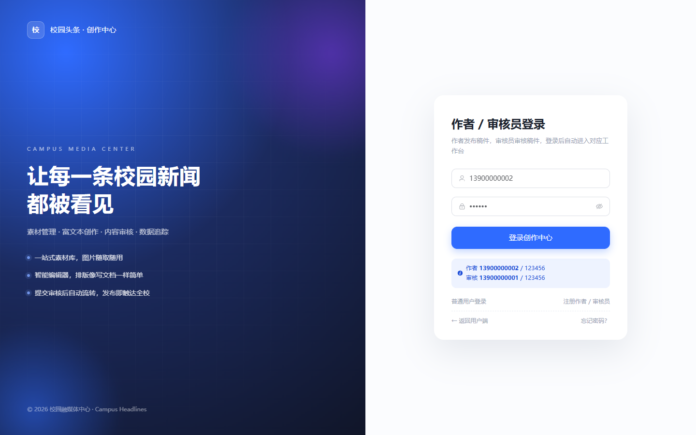
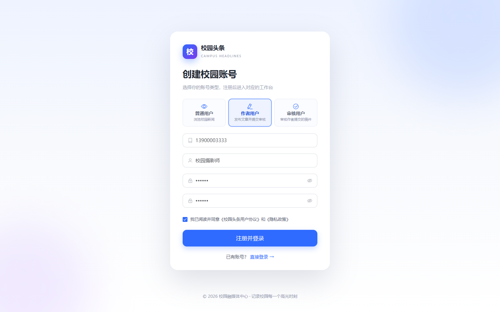
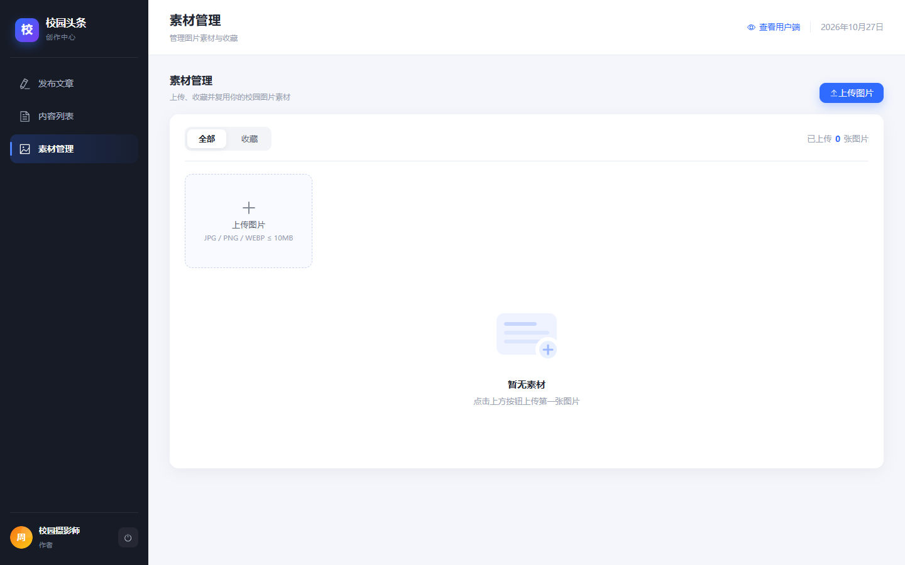
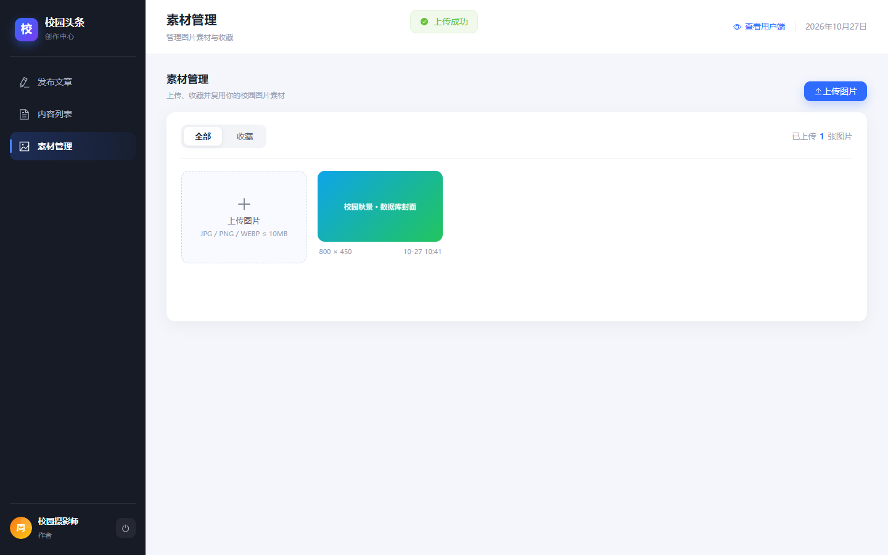
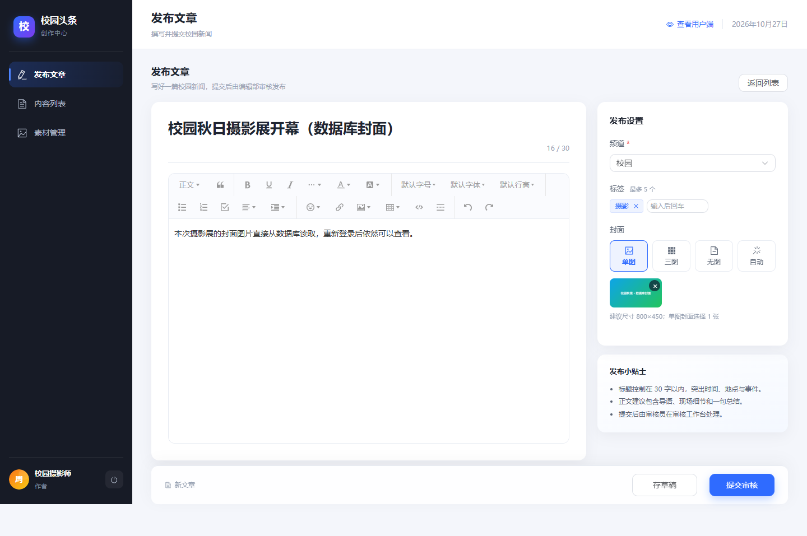
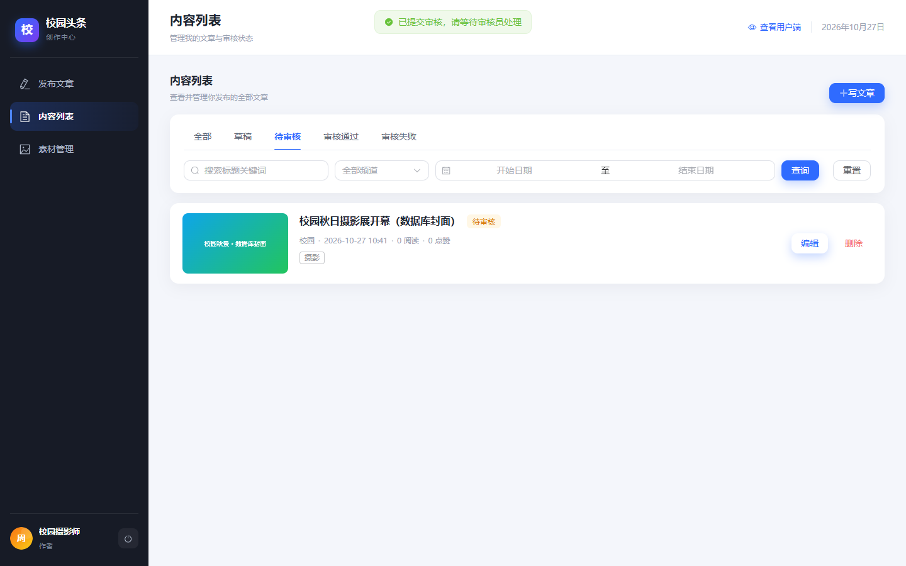
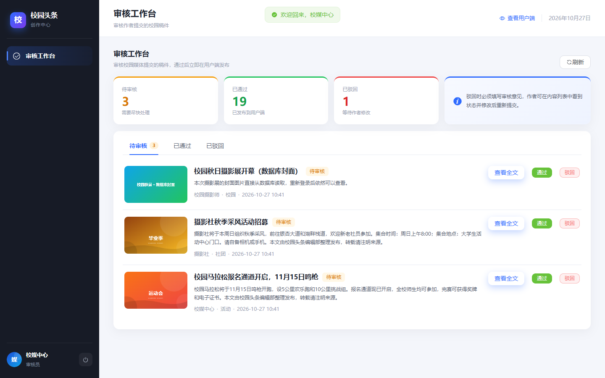
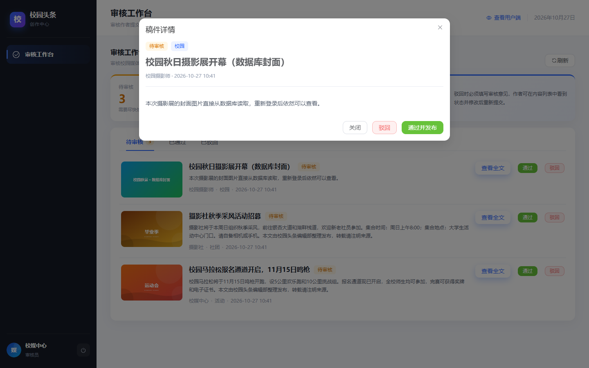
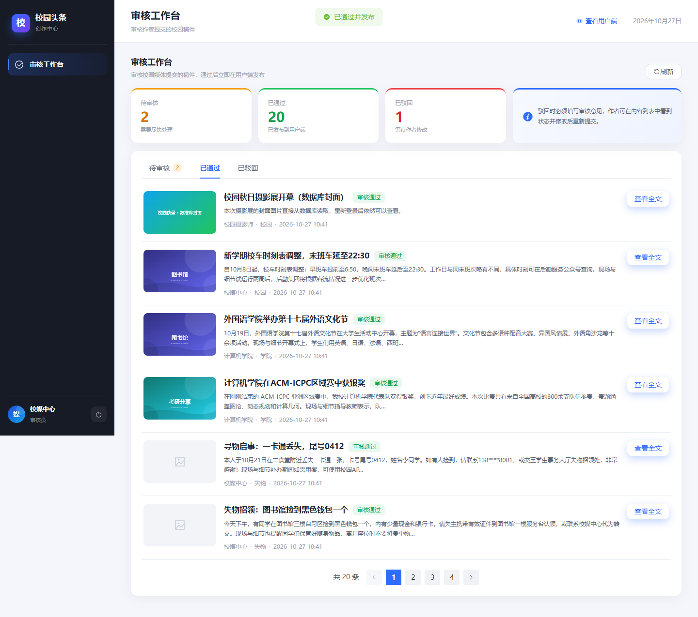
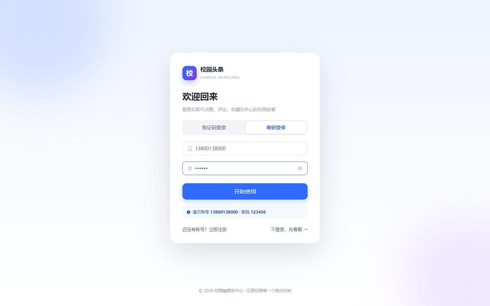

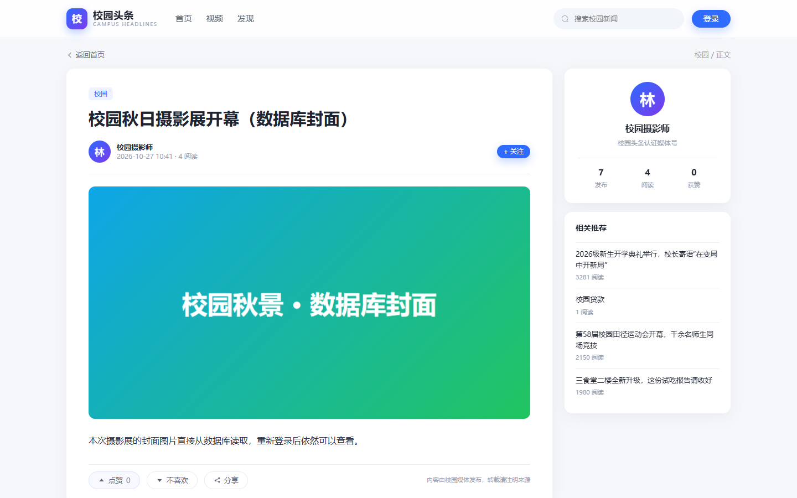
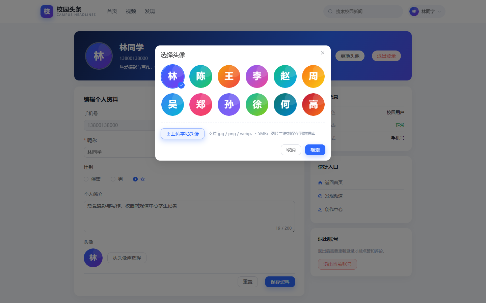
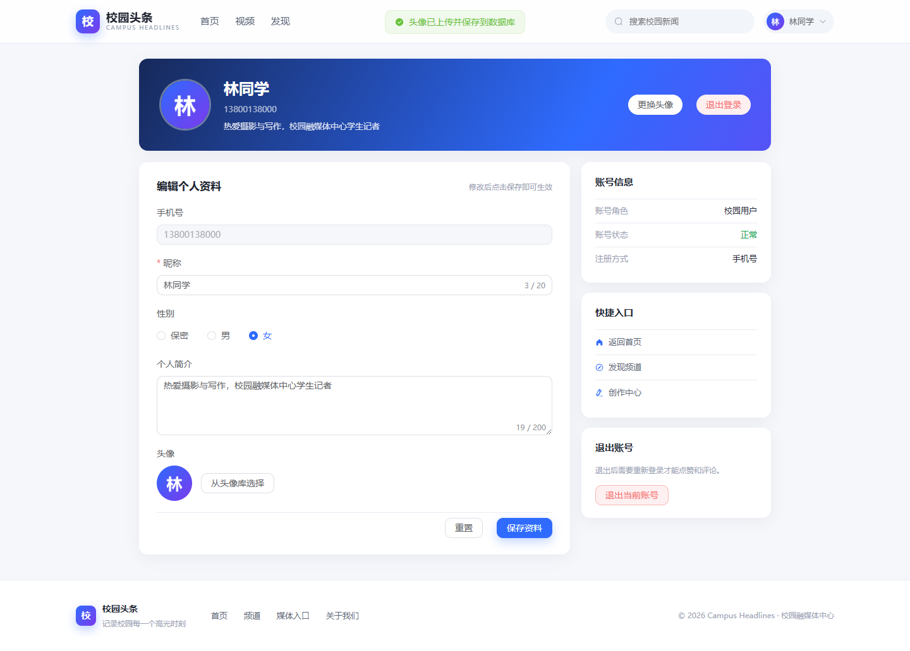

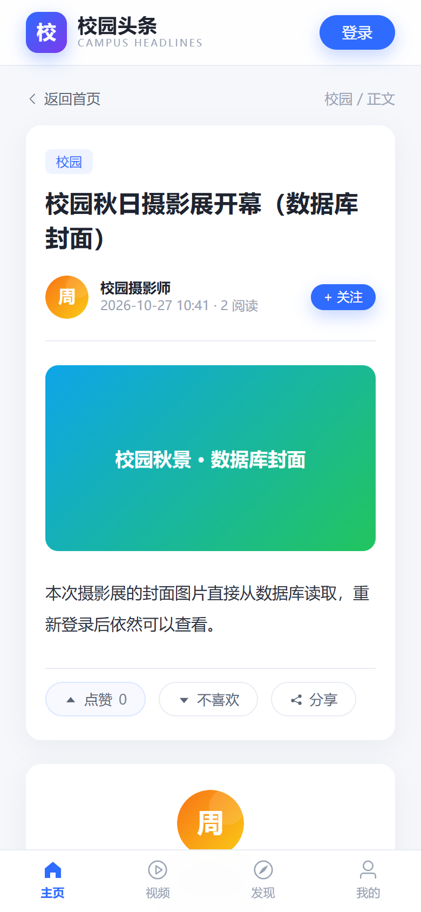

---

## 七、接口

完整示例见 docs/接口文档.md。

| 分组 | 主要接口 |
| --- | --- |
| 认证 | /api/auth/register、/api/auth/login、/api/auth/login/password、/api/media/auth/login |
| 资料 | /api/auth/me、/api/auth/profile、/api/auth/avatar、/api/auth/avatar/{id} |
| 创作端资料 | /api/media/auth/me、/api/media/auth/profile、/api/media/auth/avatar |
| 文件 | /api/files/material/{id}（从数据库读取封面） |
| 作者 | /api/media/materials、/api/media/news、/api/media/news/{id}/submit |
| 审核 | /api/media/audit/news、/api/media/audit/news/{id}/review |
| 用户 | /api/news、/api/news/{id}、/api/news/{id}/like、/api/news/{id}/comments |

---

## 八、常见问题

**MySQL 连接失败**：确认 MySQL80 服务 Running，.env 密码正确。

**作者无法进入创作中心**：普通用户账号（role=0）不能发布文章；请用作者账号 13900000002。

**审核工作台菜单不显示**：只有审核员账号（role=2，如 13900000001）可见。

**上传图片 404**：确认后端已重启到最新代码，图片接口为 /api/files/material/{id}。

**端口占用**：修改 .env 的端口，或执行 scripts/stop.ps1。

**恢复初始数据**：scripts/start.ps1 -Reset。

---

## 九、说明

- 头像与新闻封面均以二进制保存在 MySQL 中，不依赖本地文件目录。
- 密码使用 BCrypt 存储；JWT 有效期 7 天。
- 默认人工审核（AUTO_AUDIT=false）；改为 true 时自动通过本次启动后新提交的稿件。
- 所有封面、头像素材均为本地 SVG 或数据库图片，无外部图床依赖。

---

## 十、课程设计报告

填写完毕的课程设计报告：

- docs/《J2EE应用开发》课程设计报告（俞鑫培）.docx
- 桌面同名文件

报告按“功能列表—运行截图—项目说明—流程图—数据表—核心代码—总结—提交清单—评分表—评语”组织，含 14 张运行截图、5 段表单式代码块、业务流程图与 E-R 图。